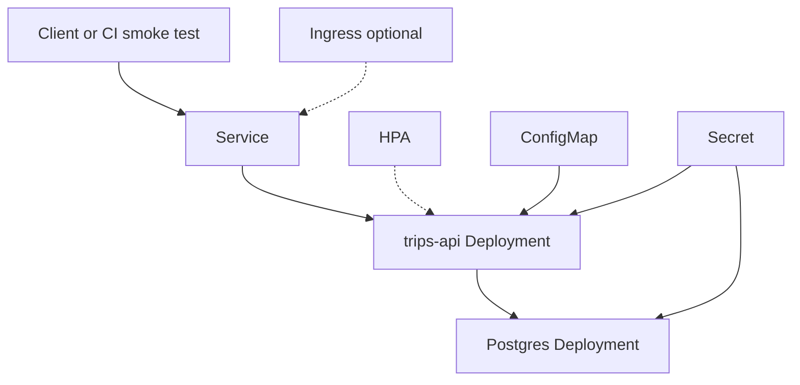

# Trips API on Kubernetes

Portfolio demo for **Arpan Bom**. This is not a production ride service. It shows a small Go HTTP API, a multi-stage container image, a Helm chart, and a GitHub Actions workflow that installs the chart on a [kind](https://kind.sigs.k8s.io/) cluster and smoke-tests it with curl.

The database password in the chart values is a demo secret. It is there so `helm install` works without an external secret manager.

## What runs

The API stores trips in Postgres.

| Method | Path | Purpose |
| --- | --- | --- |
| `GET` | `/healthz` | Liveness. Does not check the database. |
| `GET` | `/readyz` | Readiness. Pings Postgres. |
| `GET` | `/metrics` | Prometheus metrics. |
| `POST` | `/v1/trips` | Create a trip. Status starts at `requested`. |
| `GET` | `/v1/trips` | List trips, newest first. Optional `limit` from 1 to 200. |
| `GET` | `/v1/trips/{id}` | Fetch one trip. |
| `PATCH` | `/v1/trips/{id}` | Move status and optionally set `driver_id`. |

Allowed status changes:

`requested` → `accepted` or `cancelled`  
`accepted` → `in_progress` or `cancelled`  
`in_progress` → `completed` or `cancelled`

`completed` and `cancelled` are terminal. Sending the current status again is allowed.

Create body:

```json
{"rider_id":"rider-42","pickup":"1 Market St","dropoff":"Ferry Building"}
```

Update body:

```json
{"status":"accepted","driver_id":"driver-7"}
```

`STORE=memory` skips Postgres and keeps trips in the process. The chart does not set that. Kubernetes uses Postgres.

## Architecture



GitHub Actions builds the image, starts kind, loads the image and `postgres:16-alpine` into the node, and runs `helm upgrade --install`. Probes gate rollout. The smoke step port-forwards the Service and calls it with curl.

The HPA object is installed. A default kind cluster has no metrics-server, so the HPA will not scale pods until one is added. That is expected for this demo.

Postgres is a Deployment rendered by this chart when `postgresql.enabled=true`. It is a single demo database with an `emptyDir` volume, not the Bitnami chart and not a database you should keep data in.

## Layout

```text
cmd/trips-api/          process entrypoint
internal/config/        environment configuration
internal/httpapi/       routes, probes, handlers
internal/store/         memory store and Postgres
internal/metrics/       Prometheus collectors
internal/trip/          trip model and status rules
charts/trips-api/       Helm chart
scripts/smoke.sh        curl checks used by CI
.github/workflows/ci.yml
```

## Run the unit tests

```bash
go test ./...
```

Requires Go 1.25.

In-memory server, no Kubernetes:

```bash
STORE=memory go run ./cmd/trips-api
curl -s localhost:8080/healthz
```

Image:

```bash
docker build -t trips-api:local .
docker run --rm -e STORE=memory -p 8080:8080 trips-api:local
```

## Run it locally with kind

These are the same steps the `kind deploy and smoke` job runs. You need Docker, kind, kubectl, and Helm 3.

```bash
docker build -t trips-api:ci .
kind create cluster --name trips
docker pull postgres:16-alpine
kind load docker-image trips-api:ci --name trips
kind load docker-image postgres:16-alpine --name trips

helm upgrade --install trips-api charts/trips-api \
  --namespace trips \
  --create-namespace \
  --set image.repository=trips-api \
  --set image.tag=ci \
  --set image.pullPolicy=IfNotPresent \
  --wait \
  --timeout 4m

kubectl -n trips rollout status deployment/trips-api
kubectl -n trips port-forward svc/trips-api 8080:80
```

In another shell:

```bash
bash scripts/smoke.sh
```

`image.pullPolicy=IfNotPresent` matters. kind serves the image that was loaded into the node. The tag above is `ci`, not `latest`, so Kubernetes does not try to pull it from a registry.

Ingress stays off unless you install a controller and set `ingress.enabled=true`.

Tear down:

```bash
kind delete cluster --name trips
```

## Chart values

Defaults live in `charts/trips-api/values.yaml`.

| Key | Default | What it does |
| --- | --- | --- |
| `replicaCount` | `1` | API replicas when `autoscaling.enabled` is false. Ignored while the HPA is on. |
| `image.repository` | `trips-api` | Image name. CI sets this to the image loaded into kind. |
| `image.tag` | `local` | Image tag. CI sets `ci`. |
| `image.pullPolicy` | `IfNotPresent` | Use a preloaded kind image. Set `IfNotPresent` or `Always` when pulling from a registry. |
| `service.type` | `ClusterIP` | Service type. |
| `service.port` | `80` | Service port. |
| `service.targetPort` | `8080` | Container port. |
| `config.addr` | `:8080` | Listen address inside the container. |
| `config.logLevel` | `info` | `debug`, `info`, `warn`, or `error`. |
| `database.host` | `""` | Empty uses the bundled Postgres service. Required when `postgresql.enabled` is false. |
| `database.port` | `5432` | Postgres port. |
| `database.name` | `trips` | Database name. |
| `database.user` | `trips` | Database user. |
| `database.password` | `trips-demo` | Demo password, stored in a Secret. Not for production. |
| `database.sslmode` | `disable` | Passed to the Postgres client. |
| `resources.requests.cpu` | `50m` | API CPU request. |
| `resources.requests.memory` | `64Mi` | API memory request. |
| `resources.limits.cpu` | `500m` | API CPU limit. |
| `resources.limits.memory` | `256Mi` | API memory limit. |
| `probes.liveness.path` | `/healthz` | Liveness path. |
| `probes.liveness.initialDelaySeconds` | `5` | Delay before the first liveness probe. |
| `probes.liveness.periodSeconds` | `10` | Liveness period. |
| `probes.readiness.path` | `/readyz` | Readiness path. |
| `probes.readiness.initialDelaySeconds` | `2` | Delay before the first readiness probe. |
| `probes.readiness.periodSeconds` | `5` | Readiness period. |
| `autoscaling.enabled` | `true` | Create an HPA. |
| `autoscaling.minReplicas` | `1` | HPA minimum. |
| `autoscaling.maxReplicas` | `3` | HPA maximum. |
| `autoscaling.targetCPUUtilizationPercentage` | `80` | CPU target. Needs metrics-server to act. |
| `ingress.enabled` | `false` | Create an Ingress. Off in CI. |
| `ingress.className` | `nginx` | Ingress class, used only when ingress is enabled. |
| `ingress.host` | `trips.local` | Ingress host. |
| `ingress.path` | `/` | Ingress path. |
| `ingress.annotations` | `{}` | Extra ingress annotations. |
| `ingress.tls` | `[]` | Optional TLS block. |
| `postgresql.enabled` | `true` | Render the demo Postgres Deployment and Service. |
| `postgresql.image.repository` | `postgres` | Postgres image. |
| `postgresql.image.tag` | `16-alpine` | Postgres tag. |
| `postgresql.image.pullPolicy` | `IfNotPresent` | Postgres pull policy. |
| `postgresql.persistence.enabled` | `false` | `false` uses emptyDir. `true` creates a 1Gi PVC. |
| `postgresql.persistence.size` | `1Gi` | PVC size when persistence is enabled. |
| `postgresql.resources.requests.cpu` | `100m` | Postgres CPU request. |
| `postgresql.resources.requests.memory` | `256Mi` | Postgres memory request. |
| `postgresql.resources.limits.cpu` | `1` | Postgres CPU limit. |
| `postgresql.resources.limits.memory` | `512Mi` | Postgres memory limit. |
| `serviceAccount.create` | `true` | Create a ServiceAccount for the API. |
| `serviceAccount.name` | `""` | Override the ServiceAccount name. |
| `nameOverride` | `""` | Override the chart name used in resource names. |
| `fullnameOverride` | `""` | Override the full resource name. |

Install against an external database:

```bash
helm upgrade --install trips-api charts/trips-api \
  --set postgresql.enabled=false \
  --set database.host=my-postgres.example \
  --set database.password=replace-me
```

## Continuous integration

`.github/workflows/ci.yml` has two jobs:

1. `go test ./...`, `helm lint`, and `helm template` for the default install, with Ingress on, and with external database settings.
2. Build the image, create a kind cluster, `helm upgrade --install` the chart with bundled Postgres, wait for both Deployments, check that the Service, ConfigMap, Secret, and HPA exist, then run `scripts/smoke.sh` through `kubectl port-forward`.

The workflow does not push the image to a registry.
